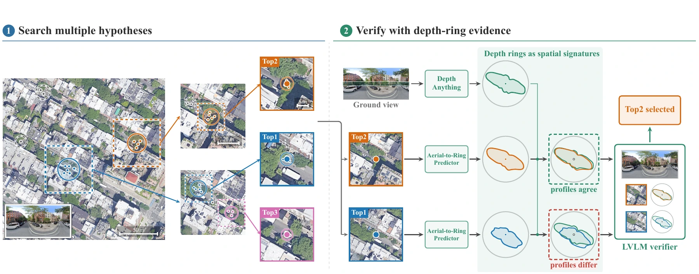

<h1 align="center">RingMatch</h1>

<p align="center">
  <strong>Beyond Local Refinement: Wide-Area Precise Cross-View Localization</strong>
</p>

<p align="center">
  <a href="https://github.com/qghuxmu">Qingguo&nbsp;Hu</a><sup>1</sup> ·
  Xinyu&nbsp;Ma<sup>3</sup> ·
  <a href="https://yujielin2000.github.io/">Yujie&nbsp;Lin</a><sup>1</sup> ·
  Yaoxiang&nbsp;Wang<sup>1</sup><br>
  Qi&nbsp;Shi<sup>2</sup> ·
  <a href="https://guozonghao96.github.io/">Zonghao&nbsp;Guo</a><sup>2</sup> ·
  Chi&nbsp;Chen<sup>2,*</sup> ·
  <a href="https://cdmc.xmu.edu.cn/en/info/1010/1008.htm">Jinsong&nbsp;Su</a><sup>1,*</sup>
</p>

<p align="center">
  <sup>1</sup> Xiamen University &nbsp;·&nbsp;
  <sup>2</sup> Tsinghua University &nbsp;·&nbsp;
  <sup>3</sup> University of Macau<br>
  <em>* Corresponding authors</em>
</p>

<p align="center">
  <a href="https://arxiv.org/pdf/2611.04759"><strong>Paper (PDF)</strong></a> &nbsp;·&nbsp;
  <a href="https://qghuxmu.github.io/RingMatch/"><strong>Project page</strong></a> &nbsp;·&nbsp;
  <a href="https://qghuxmu.github.io/RingMatch/#rm-motion"><strong>Interactive demo</strong></a> &nbsp;·&nbsp;
  <a href="#citation"><strong>Citation</strong></a>
</p>

## Method

RingMatch localizes a ground panorama within a wide aerial region. The paper introduces VIGOR-Pro to evaluate this task at aerial extents up to 400 m.

[](docs/assets/method_framework.png)

1. **Search multiple hypotheses.** Sample and cluster coordinate predictions, then progressively zoom into promising regions to refine candidate locations.
2. **Verify with depth rings.** Compare the ring derived from the ground panorama with rings predicted from the candidate aerial patches. A vision-language model uses the aligned rings and visual context to select the final location.

## Code release

**Coming soon.** The RingMatch implementation and usage instructions will be released here. The [interactive demo](https://qghuxmu.github.io/RingMatch/#rm-motion) shows eight recorded inference cases, from search through verification.

## Citation

```bibtex
@misc{hu2026localrefinementwideareaprecise,
  title={Beyond Local Refinement: Wide-Area Precise Cross-View Localization},
  author={Qingguo Hu and Xinyu Ma and Yujie Lin and Yaoxiang Wang and Qi Shi and Zonghao Guo and Chi Chen and Jinsong Su},
  year={2026},
  eprint={2611.04759},
  archivePrefix={arXiv},
  primaryClass={cs.CV},
  url={https://arxiv.org/abs/2611.04759}
}
```
